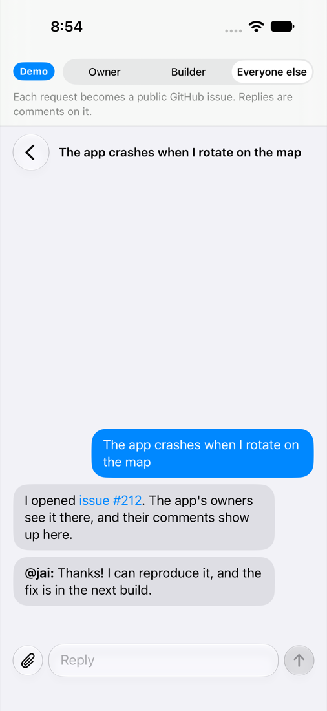

# FeedbackKit

> In-app feedback where each request is a chat with the coding agent that changes the app.

[](https://github.com/jai/feedbackkit/actions/workflows/test-unit-kit.yml)
[](https://github.com/jai/feedbackkit/releases)


FeedbackKit is a Swift package for iPhone, iPad and Mac apps. The app shows a list of feedback chats. What happens
to a new request depends on who sends it:

- **Owners**: a coding agent makes the change, tests it and ships a build.
- **Builders**: a coding agent makes the change and opens a pull request for an owner to merge.
- **Everyone else**: the request becomes a public GitHub issue. Owners' comments on the issue show in the chat.

<p>
  
  
  
</p>

---

## 🚀 Add it to an app

Add the package. Each [release](https://github.com/jai/feedbackkit/releases) is a tag, so pin a version:

```swift
.package(url: "https://github.com/jai/feedbackkit", from: "0.3.0")
```

Show the feedback screen:

```swift
let client = FeedbackClient(baseURL: { workerURL }, bearer: { try await token() })
let feedback = FeedbackRequestsModel(client: client)

FeedbackRequestsView(model: feedback)   // the list and New; a chat pushed on iPhone, beside the list on iPad and Mac
```

- `workerURL` is the app's own backend. It serves `GET/POST /feedback` and `/feedback/<id>` and forwards each call to
  the FeedbackKit Worker. [docs/api.md](docs/api.md) has the routes.
- An app with its own backend client can conform it to `FeedbackConnection` and pass
  `FeedbackClient(connection:)`. PRHub and Agent Pager do this through `FeatureKit` in
  [jai/prhub](https://github.com/jai/prhub).
- `FeedbackSamples` runs the screens with no backend, for UI tests and screenshots.
- The chat comes from [AgentChatKit](https://github.com/jai/agentchatkit), re-exported, so it uses the app's
  `ChatTheme`.

## 🧩 How it fits together

- **The package** (`Sources/FeedbackKit`): the screens and the client.
- **The FeedbackKit Worker** (`worker/`): a Cloudflare Worker, deployed as `featurekit`, that keeps every app's
  feedback. It sends owners' and builders' messages to the runner and opens issues for everyone else.
  [docs/worker.md](docs/worker.md) explains who gets what and how to deploy it.
- **The runner** (`runner/`): a long-running process on Jai's Mac mini. It runs each chat in an Orca project for that
  app on a builder Mac. [runner/README.md](runner/README.md) explains it and how to install it.
  [Set up a builder Mac for Feedback](https://github.com/jai/agent-pager#set-up-a-builder-mac-for-feedback) has the
  steps.

## 📱 Try the demo

`Demo/` is an iPhone and Mac app that runs on a mock Worker inside the app, so no data leaves the device. A switch at
the top picks who is sending: owner, builder or everyone else.

```sh
brew install xcodegen                                 # XcodeGen makes the Xcode project from Demo/project.yml
cd Demo && xcodegen && open FeedbackDemo.xcodeproj    # run the FeedbackDemo scheme on an iPhone simulator or My Mac
```

- A message goes from pending to delivered, and the mock agent answers a few seconds later.
- To use a deployed Worker, hold the Demo badge. A hidden setting takes the Worker URL and a token, which the app keeps in
  the Keychain.

## 🔧 Develop

- **Package units**: `swift test --jobs 2 --filter FeedbackKitTests`.
- **Package integration**: `swift test --jobs 2 --filter FeedbackKitIntegrationTests` runs 14 tests of isolated
  preferences and AgentChatKit's loopback ACP dev host. Set `AGENTCHAT_DEV_HOST` to reuse a prepared local host.
- **Package rendering UI**: `swift test --jobs 2 --filter FeedbackKitRenderingTests` runs two macOS pixel-rendering
  tests. `make test-ui-kit PLATFORM=mac` runs these before the native app UI plan.
- **Worker**: in `worker/`, run `npm ci`, `npm test` and `npm run typecheck`.
- **Runner**: `make -C runner test` (Python 3.14, standard library only); `make test-unit-kit` uses pytest with sockets disabled for the 38 isolated cases; `make test-integration-kit` runs the 89 storage/process cases.
- **Demo UI tests**: generate `Demo/FeedbackDemo.xcodeproj` with XcodeGen, then use `FeedbackDemo` with the full
  `SDK-iOS` plan or `FeedbackDemoMac` with `SDK-macOS`. They exercise FeedbackKit's screens and adapters on controlled
  data, not the deployed system. Start the matching AgentChatKit ACP dev host locally for live fixtures; its default
  address is `http://127.0.0.1:8788`, overridden with `TEST_RUNNER_FEEDBACKKIT_LIVE_SERVER`. With
  `TEST_RUNNER_FEEDBACKDEMO_SCREENSHOTS=<folder>` set, the tests also write the screenshots above.

[docs/end-to-end-walkthrough.md](docs/end-to-end-walkthrough.md) is the whole path by hand: the demo, a
sample backend deployed and torn down by one workflow, a coding thread that changes the demo, and the rebuilt demo.

Run `make worker-setup sample-setup runner-setup` once to prepare pinned Node and Python dependencies.
`make lint-kit`, `make test-unit-kit` and `make test-integration-kit` match the named workflows. Unit checks include
Swift SDK and menu logic, Worker/sample logic and the Python runner, with network guards and randomized order.
For local ACP integration, start `.build/checkouts/agentchatkit/server/dev/host.ts --port 8788` with Node 26 after
`swift package resolve`, then set `AGENTCHAT_DEV_HOST=http://127.0.0.1:8788` if reusing it. Native UI uses the full
plans through `make test-ui-kit PLATFORM=ios SIMULATOR=<id>` or `PLATFORM=mac`.

The release workflow validates a `rc-kit-v<version>-<commit>` through the separate lint, unit, integration and UI
workflows, then publishes the same tested commit as `v<version>`. See [docs/workflow.md](docs/workflow.md) for setup,
cleanup, triggers and the existing runner update channels. External clock/runner enablement is managed separately.

**Never breaking** (Jai, 2026-11-16: "always latest, never breaking"). Apps take every release automatically, so a
release must never break one:

- Add to the public API. Never remove or change a public signature.
- To retire one, deprecate it and keep it working.
- `make lint-kit` runs `swift package diagnose-api-breaking-changes <latest release tag>` and fails on any break,
  which also holds the release.
- A deliberate break needs Jai's OK and a major version.

## License

[MIT](LICENSE)


## Shared agent-chat rows and actions

The conversation list uses AgentChatKit's `ChatThreadList` and `ChatThreadRow`; message delivery uses its shared ticks
and status view. A host can keep its own live status and chip accessories in the same row. Each `FeedbackThread`
includes `thread: FeedbackAgentThread?` (host and id) once the runner has started that agent; older Workers omit it.

```swift
FeedbackRequestsView(model: feedbackModel) { conversation in
    hostedConversation(conversation)
}
.threadRows(label: { feedback in
    guard let reference = feedback.thread else { return nil } // the shared default row while starting
    return rowForAgentThread(reference)
}, actions: { feedback in
    ChatThreadActions(
        archive: { await hideFeedbackLocally(feedback.id) },
        delete: { await deleteFeedbackInThisHost(feedback.id) }
    )
})
```

Row labels return `AnyView?`; nil keeps FeedbackKit's shared default. Hooks return
`Result<Void, ChatActionError>`. Archive and Delete appear only when their hook exists. Delete asks for confirmation;
pending actions disable the row, and failures show the host's error. The kit never translates an action into removal
of an Orca workspace, a Rex session or another agent's files. The host defines that operation.

`threadRows` preserves Feedback's value-based navigation, selected conversation, New flow, and draft handoff.

## Direct/v2 live adoption

For a host migrating to the Worker's app-signed tokens, use an explicit **Worker root before `/v2`**:

```swift
let feedback = FeedbackRequestsModel(client: FeedbackClient(direct: FeedbackDirect(
    baseURL: feedbackWorkerRoot,
    token: { renew in try await appTokens.feedbackKitToken(renew: renew) }
)))

FeedbackRequestsView(model: feedback)
    .threadRows(label: { thread in hostRow(thread) }, actions: { thread in hostActions(thread) })
    .liveControls(identifiers: FeedbackLiveIdentifiers())
```

`token(true)` must invalidate the app's cached token and ask its backend for a new one. A request refused with 401 is
retried once with the same body and `client_ref`; other failures are not retried automatically. A manual resend of
the unchanged restored draft keeps its original key. Creation, normal replies (including build and screenshots),
and listing use `/v2/feedback`. Open conversations use `/v2/acp`, including when idle. Reconnects never switch to
REST polling. Issue chats are not served by ACP; their bootstrap/POST response remains visible with an unavailable
live notice. Hosts needing the old issue refresh behavior can retain a legacy connection until migrating that flow.

FeedbackKit caches one `LiveChatModel` and its shared `LiveChatControls` per conversation. It derives the visible
transcript and FeedbackKit metadata from the live state; the optional one-time REST snapshot is not updated by the
stream. Following stops on disappearance, background, or successful host-conversation handoff. Handoff still waits
for confirmed delivery and a nonblank `{host,id}`, and passes the same draft binding and attachment tray.

The chat uses `LiveQueuedReplies`, `LiveReplyStatus`, `LiveQuestionView`, and `LiveScreenshotStrip`. Queued messages
appear only in the strip. Pending/queued Cancel uses remove; Send now and question answers use the shared live APIs.
FeedbackKit itself never queues or asks questions; the adapters can still render these when a compatible host supplies
them. Failed Retry uses the live model’s force-edit operation, preserving the message ID and client reference.
`FeedbackDirect(retry:)` optionally overrides that operation for a host.

Screenshots resolve relative to the ACP endpoint. Only same-origin HTTPS images receive the FeedbackKit bearer;
external signed HTTPS images receive none. Other schemes and embedded credentials are refused. Image requests use
DurableNetworking’s quick transport by default; hosts can supply their image transport policy.
Screenshot accessibility identifiers use message id and original attachment index, never a signed URI.

`FeedbackDirect` accepts `http`, `streams`, `images`, and an optional `liveFactory` for deterministic hosts, previews,
and tests. Its defaults are DurableNetworking's `URLSessionTransport(policy: .quick)` and
`URLSessionStreamingTransport(quietLimit: 40)`. FeedbackKit declares a direct DurableNetworking dependency because
its public configuration accepts these transport protocols and supplies those concrete defaults. AgentChatLive and
AgentChatLiveTesting are products of AgentChatKit; the integrating parent must set its released minimum version.
The existing dependency floor is intentionally unchanged here; there is no local-path pin.

Legacy `FeedbackConnection`, `URLFeedbackConnection`, `FeedbackClient(baseURL:bearer:samples:)`, samples, and
`Feature*` aliases remain source-compatible. A legacy backend URL is never used to infer an ACP endpoint.

The demo's `FEEDBACKKIT_LIVE_FIXTURE=status|queue|question|screenshots` launch environment selects controlled REST
responses and AgentChatKit's loopback ACP dev host through this public direct API.
`FEEDBACKKIT_DEMO_APPEARANCE=light|dark|large` controls capture variants.
The screenshot resource is a copy of the existing captured FeedbackKit demo list, not a synthetic screen. Shared UI
tests attach real `XCUIScreen` captures and optionally write them under `FEEDBACKDEMO_SCREENSHOTS`.
The full-target iPhone and Mac plans cover FeedbackKit's role flows, handoff and adapter wiring. AgentChatKit owns
shared delivery ticks, appearance matrices and screenshot-viewer behavior, so those checks stay in its own suite.
