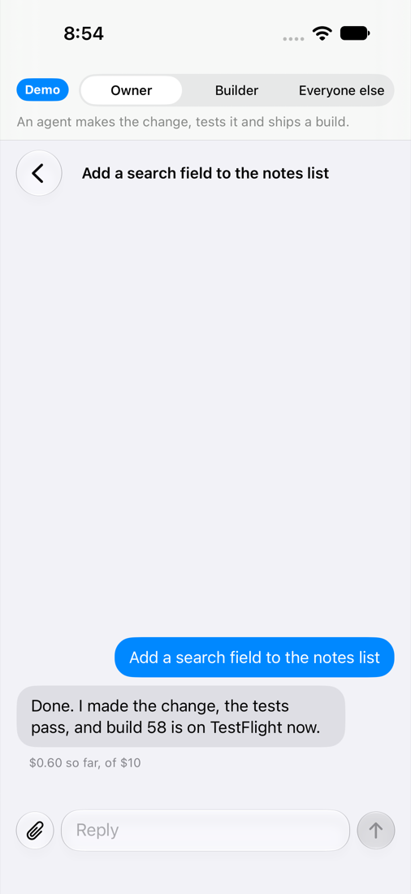

# FeedbackKit

> Feedback from inside an app: each request is a conversation with the coding agent that changes the app.

The app shows `FeedbackRequestsView`; each conversation goes to the app's Worker (`GET/POST /feedback` and
`/feedback/<id>`), which hands it to the FeedbackKit Worker. A request from one of the app's owners starts a coding
session that makes the change; anyone else's becomes a GitHub issue.

This repo holds both sides:

- `Sources/FeedbackKit`: the Swift package, the screens and the client.
- `worker/`: the FeedbackKit Worker (`featurekit` on Cloudflare), which keeps every app's feedback, hands owners' and
  builders' messages to the runner on Jai's Mac, and opens issues for everyone else ([docs/worker.md](docs/worker.md)).
- The runner is not in this repo: it is the threads hub on Jai's Mac mini, in jai/agent-pager. It runs each chat in an
  Orca project per app on a builder Mac. To set up a builder, see
  [Set up a builder Mac for Feedback](https://github.com/jai/agent-pager#set-up-a-builder-mac-for-feedback).
- [docs/api.md](docs/api.md): the routes an app's backend serves and forwards.

The chat is [AgentChatKit](https://github.com/jai/agentchatkit)'s, re-exported, so it takes the app's `ChatTheme`.

## Use it

```swift
.package(url: "https://github.com/jai/feedbackkit", from: "0.1.0")
```

```swift
let client = FeedbackClient(baseURL: { workerURL }, bearer: { try await token() })
let feedback = FeedbackRequestsModel(client: client)

FeedbackRequestsView(model: feedback)   // the list and New; a conversation pushed on iPhone, beside it on iPad and Mac
```

- A host with its own Worker client conforms it to `FeedbackConnection` and passes `FeedbackClient(connection:)`.
  PRHub and Agent Pager use jai/prhub's `FeatureKit`, which does this over PRKit's `PRViewerClient`.
- `FeedbackSamples` runs it with no Worker, for UI tests and screenshots.

## Demo

`Demo/` is an iPhone and Mac app that shows how it works, on a mock Worker in the app: nothing leaves the device.
Switch who is sending to see each experience.

- **Owner**: an agent makes the change, tests it and ships a build. The chats show the agent working, one shipped, and
  one whose message never reached the builder Mac.
- **Builder**: the same, but the agent opens a pull request for an owner to merge.
- **Everyone else**: each request becomes a public GitHub issue; owners' comments on it show in the chat.

A message goes pending, delivering, delivered, and the mock agent answers a few seconds later. Holding the Demo badge
opens a hidden setting that points the app at a real Worker URL and token instead (off by default; the token stays in
the Keychain).

<p>
  
  
  
</p>

```sh
cd Demo && xcodegen && open FeedbackDemo.xcodeproj   # scheme FeedbackDemo, iPhone or My Mac
```

The demo hosts this repo's UI test (`FeedbackDemoUITests`), which walks each role and writes these screenshots when run
with `TEST_RUNNER_FEEDBACKDEMO_SCREENSHOTS=<folder>`.

## Develop

- Swift: `swift test`. Swift 6, iOS 26 and macOS 26.
- Demo and UI test: `xcodegen` in `Demo/`, then build or test the `FeedbackDemo` scheme.
- Worker: `npm ci`, `npm test` and `npm run typecheck` in `worker/`. Deploy: [docs/worker.md](docs/worker.md#deploy).
- CI (`ci.yml`) runs all three on every push to main, the demo's UI test end to end on an iPhone simulator.
- Releases: once an hour `release.yml` tags main's newest green commit (`release/`, Conventional Commits) when a
  feat, fix or breaking change is waiting. Don't tag by hand.
