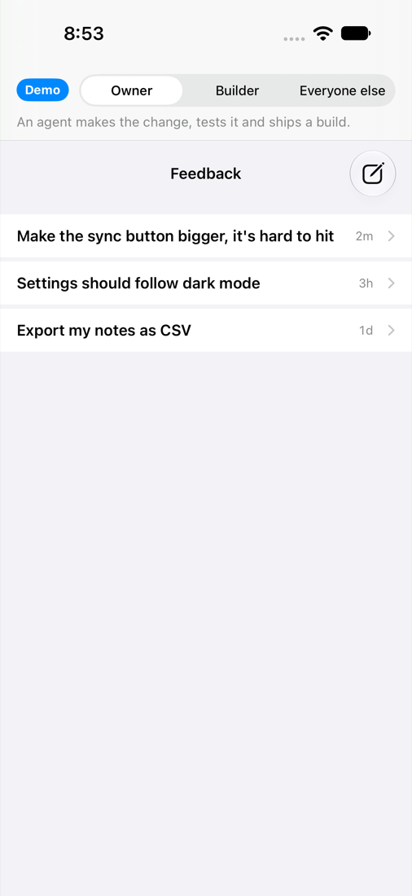

# FeedbackKit

> In-app feedback where each request is a chat with the coding agent that changes the app.

[](https://github.com/jai/feedbackkit/actions/workflows/test-unit-kit.yml)
[](https://github.com/jai/feedbackkit/releases)


FeedbackKit is a Swift package for iPhone, iPad and Mac apps, plus the service behind it. It is for the people who
build an app with coding agents and want feedback from inside the app to turn into changes. The app shows a list of
feedback chats. Each app's config decides what a new request becomes, by who sends it:

- **Owners**: a coding agent makes the change, tests it and ships a build.
- **Builders**: a coding agent makes the change and opens a pull request for an owner to merge.
- **Everyone else**: the request becomes a public GitHub issue. Comments on the issue show in the chat.

<p>
  
  
  
</p>

---

## 🧩 The parts

- **SDK** ([`Sources/FeedbackKit`](Sources/FeedbackKit)): the Swift package. It draws the feedback list and chats and
  sends messages.
- **Worker** ([`worker/`](worker), [docs/worker.md](docs/worker.md)): a Cloudflare Worker, deployed as `featurekit`,
  that keeps every app's feedback and opens the issues.
- **Runner** ([`runner/`](runner), [runner/README.md](runner/README.md)): a long-running process on Jai's Mac mini. It
  runs each chat as a Claude Code agent in an Orca (agent workspace app) worktree on a builder Mac.
- **Menu bar app** ([`runner/MenuBar/`](runner/MenuBar), [README](runner/MenuBar/README.md)): shows the runner's
  health on Jai's Mac and turns builders on or off.
- **Demo** ([`Demo/`](Demo)): an iPhone and Mac app that runs the SDK on a mock Worker.
- **Sample Worker** ([`sample-worker/`](sample-worker)): the smallest app backend for the direct path. It issues
  FeedbackKit tokens.

[ARCHITECTURE.md](ARCHITECTURE.md) maps the code: which part does what, where to find it, and the rules it keeps. The
diagrams show the [system context](docs/architecture/context.md), the [containers](docs/architecture/containers.md)
and the [components](docs/architecture/components.md), with a message's trip from the app to the agent and back.

## 🚀 Add it to an app

Add the package. Each [release](https://github.com/jai/feedbackkit/releases) is a tag, so pin a version:

```swift
.package(url: "https://github.com/jai/feedbackkit", from: "0.13.0")
```

Show the feedback screen:

```swift
let client = FeedbackClient(baseURL: { workerURL }, bearer: { try await token() })
let feedback = FeedbackRequestsModel(client: client)

FeedbackRequestsView(model: feedback)   // the list and New; a chat pushed on iPhone, beside the list on iPad and Mac
```

- The list is kept on the device (`FeedbackKeep`, in Application Support), so the screen opens on the requests it
  last had and reads again behind them. An app with more than one account gives each its own place and clears it at
  sign-out: `FeedbackRequestsModel(client: client, keep: .standard(named: accountID))`, `keep.clear()`; `keep: nil`
  keeps nothing.
- `workerURL` is the app's own backend. It serves `GET/POST /feedback` and `/feedback/<id>` and forwards each call to
  the FeedbackKit Worker. [docs/api.md](docs/api.md) has the routes.
- An app with its own backend client can conform it to `FeedbackConnection` and pass
  `FeedbackClient(connection:)`. PRHub and Agent Pager do this through `FeatureKit` in
  [jai/prhub](https://github.com/jai/prhub).
- `FeedbackSamples` runs the screens with no backend, for UI tests and screenshots.
- The chat comes from [AgentChatKit](https://github.com/jai/agentchatkit), re-exported, so it uses the app's
  `ChatTheme`.
- Custom thread rows and actions, and the direct `/v2` path with live chats, are in
  [SDK host integration](docs/architecture/sdk-integration.md).

### 🔔 A badge for chats that need you

`feedback.needsAttentionCount` is how many chats wait on the sender: each has a question its agent asked that they
have not answered (the rows that say **Needs you** for a question). It is observable and needs no Feedback screen:

```swift
TabView {
    Tab("Feedback", systemImage: "bubble.left.and.bubble.right") { FeedbackRequestsView(model: feedback) }
        .badge(feedback.needsAttentionCount)        // nothing shows for 0
}
.feedbackAttention(feedback)                        // reads at launch, at each foreground, then every 5 minutes

Label("Feedback", systemImage: "bubble.left").feedbackBadge(feedback)   // a list row or a sidebar item
```

- It starts from the list the device kept, so the badge is there at launch, then follows each read of the list.
- A push: `if let push = FeedbackPush(userInfo: userInfo) { await feedback.received(push) }` in the notification
  delegate. A question counts at once, and the list is read again.
- An open chat reads the list when it gains a message or its agent starts or stops, and the sender's answer takes
  its chat off the count at once.
- Left out: chats that ended, chats archived on this device, and replies that are no question. FeedbackKit keeps no
  record of what the sender has read, so there is no unread count.
- `await feedback.refresh()` reads the list where the host knows more, and outside SwiftUI.

## 📱 Try the demo

`Demo/` is an iPhone and Mac app that runs on a mock Worker inside the app, so no data leaves the device. A switch at
the top picks who is sending: owner, builder or everyone else.

```sh
brew install xcodegen                                 # XcodeGen makes the Xcode project from Demo/project.yml
cd Demo && xcodegen && open FeedbackDemo.xcodeproj    # run the FeedbackDemo scheme on an iPhone simulator or My Mac
```

- A message goes from pending to delivered, and the mock agent answers a few seconds later.
- To use a deployed Worker, hold the Demo badge. A hidden setting takes the Worker URL and a token, which the app
  keeps in the Keychain.
- [docs/end-to-end-walkthrough.md](docs/end-to-end-walkthrough.md) runs the whole path by hand: the demo, the sample
  backend deployed and torn down by one workflow, a coding agent that changes the demo, and the rebuilt demo.

## 🔧 Develop

Run `mise trust`, then `make setup` once. It prepares the pinned Node and Python dependencies and installs the git
hooks.

- `make lint-kit`: formatting, static analysis, type checks, builds and the public API check.
- `make test-unit-kit`: unit tests for the SDK, menu logic, Worker, sample Worker and runner, with network guards and
  random order. The pre-push hook runs it.
- `make test-integration-kit`: SDK, Worker and runner integration tests. The SDK's live tests use AgentChatKit's
  loopback dev host for ACP, the live chat protocol.
  - To reuse a dev host you started, set `AGENTCHAT_DEV_HOST=http://127.0.0.1:8788`.
  - To start one, run `swift package resolve`, then this with Node 26:
    `node .build/checkouts/agentchatkit/server/dev/host.ts --port 8788`.
- `make test-ui-kit PLATFORM=ios SIMULATOR=<id>` or `PLATFORM=mac`: the demo's full `SDK-iOS` or `SDK-macOS` test
  plan on controlled data, not the deployed system. Generate `Demo/FeedbackDemo.xcodeproj` with XcodeGen first. On
  macOS it runs the pixel-rendering tests first.
  - The live fixtures need the same dev host running locally, by default at `http://127.0.0.1:8788`. Set
    `TEST_RUNNER_FEEDBACKKIT_LIVE_SERVER` to use another address.
  - Set `TEST_RUNNER_FEEDBACKDEMO_SCREENSHOTS=<folder>` to write the screenshots above.
- Runner only: `make -C runner test`, on Python 3.14 with the standard library only.

The test layers, the CI workflows and the release flow are in [docs/workflow.md](docs/workflow.md). Each candidate
`rc-kit-v<version>-<commit>` passes the lint, unit, integration and UI workflows before the same commit is published
as `v<version>`.

### 🛡️ Never breaking

Jai's rule (2026-11-16): "always latest, never breaking". Apps take every release automatically, so a release must
never break one:

- Add to the public API. Never remove or change a public signature.
- To retire one, deprecate it and keep it working.
- `make lint-kit` runs `swift package diagnose-api-breaking-changes <latest release tag>` and fails on any break,
  which also holds the release.
- A deliberate break needs Jai's OK and a major version.

## License

[MIT](LICENSE)
