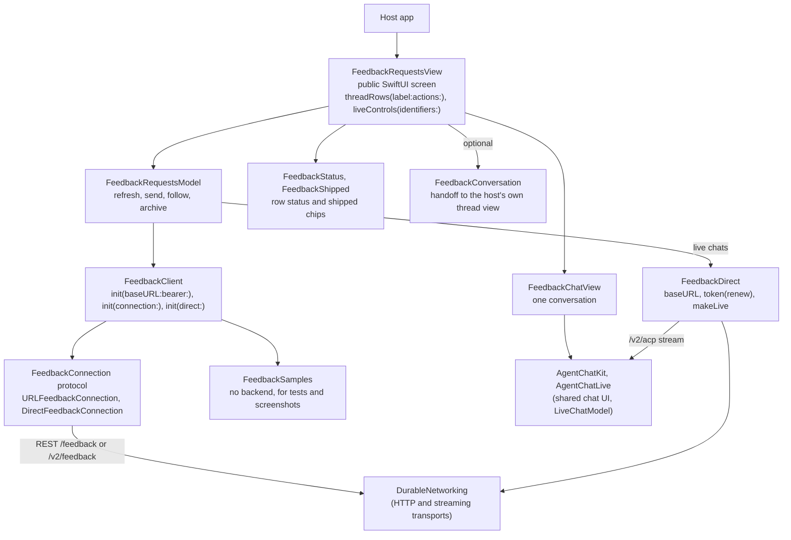
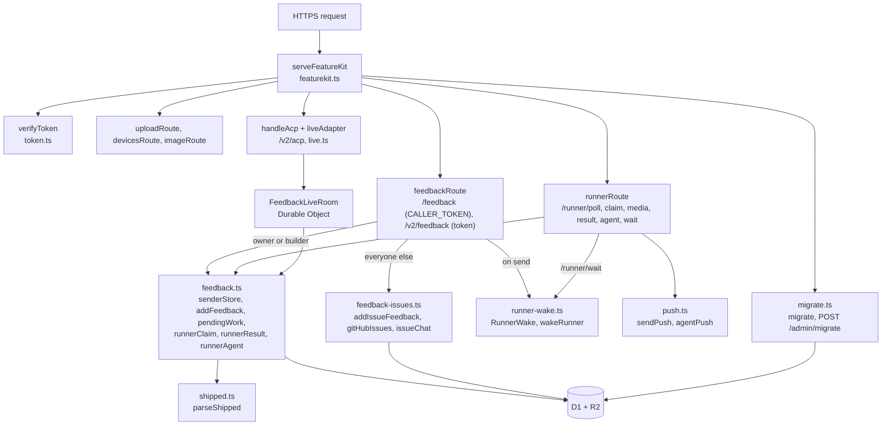
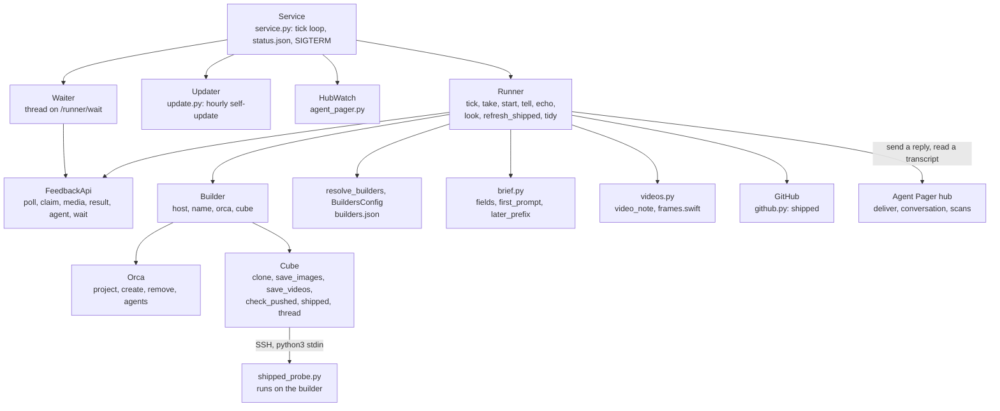
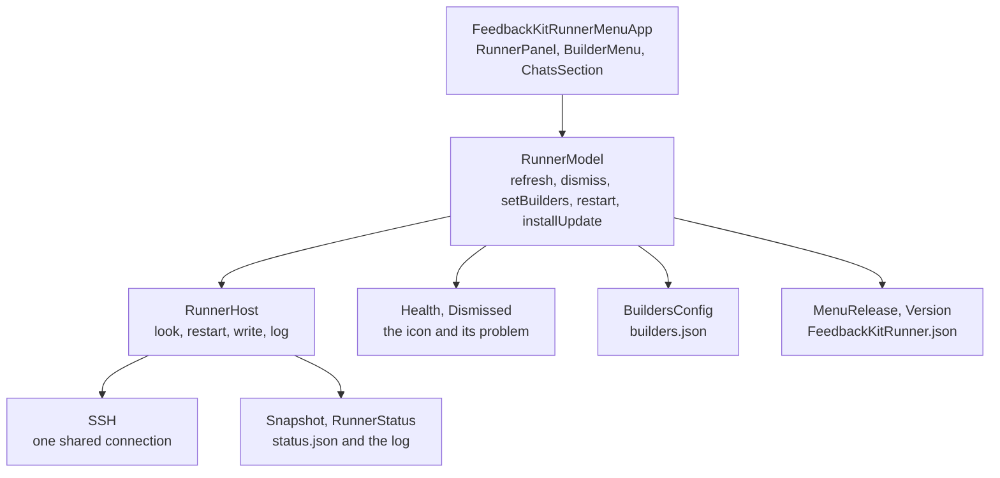
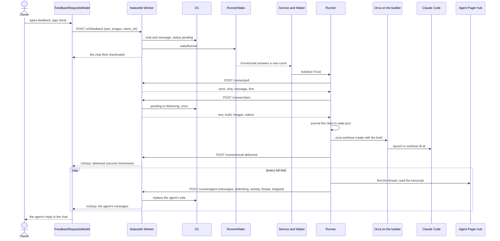

# FeedbackKit components

This page opens each container from the [containers](containers.md) page and names its main parts. Each diagram uses
the names of real types, functions and files, so you can find each one with a symbol search. The last diagram follows
one owner's message from the app to the coding agent and the agent's reply back.

Up a level: [containers](containers.md). The codemap and the invariants are in
[ARCHITECTURE.md](../../ARCHITECTURE.md).

## SDK (Swift package `FeedbackKit`)

The host app shows `FeedbackRequestsView`. The view reads and writes through `FeedbackRequestsModel`, which reaches the
Worker through `FeedbackClient`. The client has three modes: through the app's backend, direct to `/v2` with a
FeedbackKit token, or `FeedbackSamples` with no network.

## featurekit Worker (`worker/src/`)

`serveFeatureKit` routes each request by path and by token. Every route keeps its data through one `FeedbackStore`
per sender, which `senderStore` builds over D1 and R2.

## Runner (`runner/feedbackkit_runner/`)

`Service` is the process: it runs a full tick every 15 seconds and a fast tick when `Waiter` sees a wake. `Runner` does
the work of each tick. It talks to the Worker through `FeedbackApi`, to each builder's Orca through `Orca`, and to each
builder over SSH through `Cube`.

## Menu bar app (`runner/MenuBar/`)

`RunnerModel` in the `FeedbackKitRunnerMenu` app refreshes every 10 seconds. The testable logic lives in the
`RunnerMenuCore` library.

## A message from the app to the agent and back

This sequence is an owner's first message on the direct path, with the live stream on. Through an app's backend the
SDK uses `/feedback` and polls instead of the stream. A builder's message takes the same path with a different brief.

## Where in the code

- SDK screen and model: `Sources/FeedbackKit/FeedbackRequestsView.swift` and `FeedbackRequestsModel.swift`.
- SDK transport: `FeedbackClient.swift`, `FeedbackConnection.swift` and `FeedbackDirect.swift`.
- How a host plugs in its own rows, actions and live controls: [SDK host integration](sdk-integration.md).
- Worker routes and their bodies: [docs/api.md](../api.md) (app side) and
  [docs/worker.md](../worker.md#the-runners-messages) (runner side).
- Worker storage rules: [docs/worker.md](../worker.md#storage).
- Runner behavior in full: [runner/README.md](../../runner/README.md).
- The brief the agent gets: `runner/prompts/feedback-brief.md`, filled by `first_prompt`.
- Menu bar behavior: [runner/MenuBar/README.md](../../runner/MenuBar/README.md).
