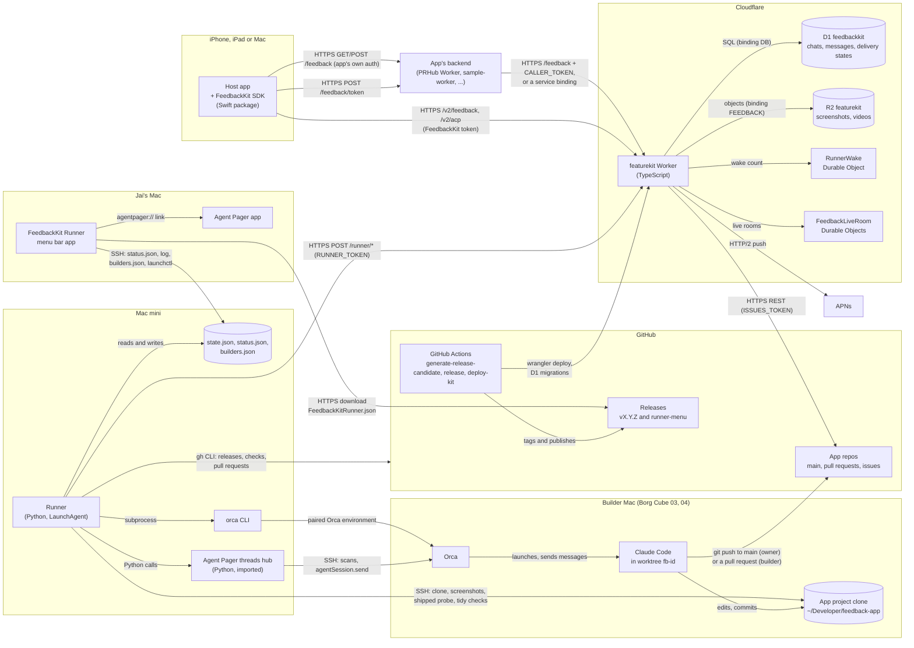

# FeedbackKit containers

This page shows the programs and data stores that make up FeedbackKit, where each one runs, and how they talk. Every
arrow names its protocol. Two rules shape the picture. First, the Worker never calls the runner: the runner polls the
Worker and holds a long poll open. Second, every coding agent runs on a builder Mac, never on the Mac mini.

Up a level: [system context](context.md). Down a level: [components](components.md).

## Where in the code

- Host app and SDK: `Sources/FeedbackKit/`. The two paths to the Worker are `URLFeedbackConnection` (through the
  app's backend) and `FeedbackDirect` (straight to `/v2`).
- App's backend: a reference one is `sample-worker/src/index.ts`. Its contract is
  [docs/worker.md](../worker.md#an-apps-backend).
- featurekit Worker: entry `serveFeatureKit` in `worker/src/featurekit.ts`. Bindings are in
  `deploy/wrangler.template.jsonc`. D1 schema is in `worker/migrations/`.
- Runner: `Service` in `runner/feedbackkit_runner/service.py` (process and loop) and `Runner` in
  `runner/feedbackkit_runner/runner.py` (the work).
- Agent Pager threads hub: loaded by `load` in `runner/feedbackkit_runner/agent_pager.py`.
- Builder side: `Orca` and `Cube` in `runner/feedbackkit_runner/runner.py`, and
  `runner/feedbackkit_runner/shipped_probe.py`, which runs on the builder.
- Menu bar app: `runner/MenuBar/`. It reaches the mini through `RunnerHost` and `SSH` in `RunnerMenuCore`.
- Release flow: `.github/workflows/generate-release-candidate.yml`, `release.yml` and `deploy-kit.yml`. The Worker
  deploy runs `deploy/deploy.sh`.
