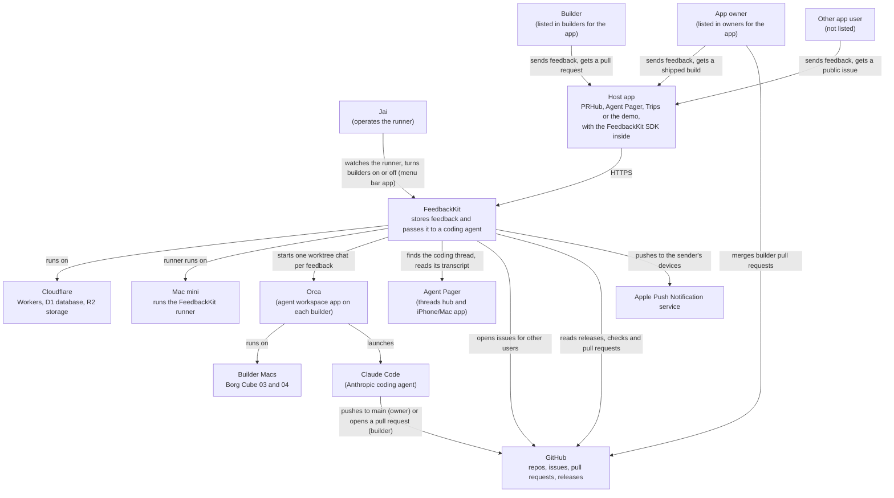

# FeedbackKit system context

This page shows FeedbackKit from the outside: the people who use it and the systems it depends on. A person sends
feedback from inside an app that embeds the FeedbackKit SDK. FeedbackKit stores the feedback on Cloudflare. For an
owner or a builder, it hands the feedback to a Claude Code agent on a builder Mac. For everyone else, it opens a
public GitHub issue.

Next level of detail: [containers](containers.md), then [components](components.md). The codemap is in
[ARCHITECTURE.md](../../ARCHITECTURE.md).

## Where in the code

- Who gets what (owner, builder, everyone else): `roleOf` and `parseApps` in `worker/src/featurekit.ts`.
- The apps and their people: `APPS` in `deploy/wrangler.template.jsonc`.
- The public issue path: `worker/src/feedback-issues.ts`.
- The coding-agent path: `Runner` in `runner/feedbackkit_runner/runner.py`.
- The builder Macs: `BUILDERS` in `runner/feedbackkit_runner/runner.py`.
- Pushes: `worker/src/push.ts`.
- Rules for each role, as people read them: [docs/worker.md](../worker.md#who-gets-what).
