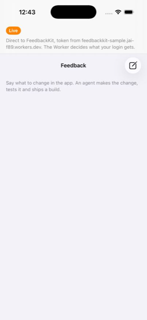
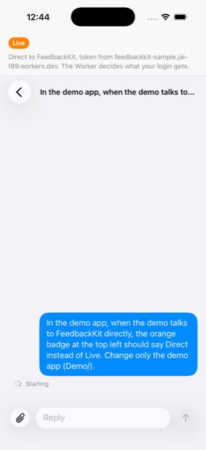
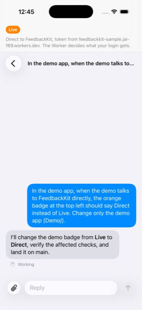
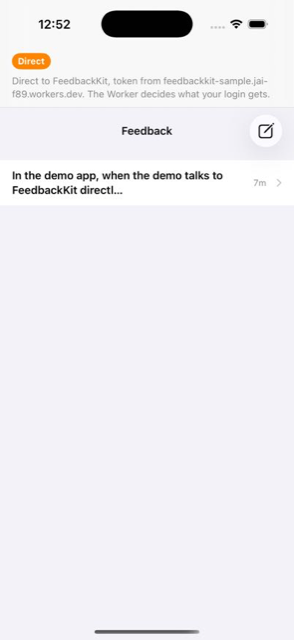

# End-to-end walk-through

FeedbackKit's own demo, by hand, from a message on the phone to the change in a rebuilt demo. Any agent can repeat it
when Jai asks. Last run: 2026-11-15 on Borg Cube 03 (results and timings below).

## Not covered until G5

- **Pushes to a device.** The demo does not register for pushes until the client work (G5) lands, it is not signed
  for APNs, and Cube 03 cannot reach APNs. The Worker's side is proven separately: `POST /admin/apns-check` (bearer
  `ADMIN_TOKEN`) answers `BadDeviceToken` from both APNs hosts, so the team key and topics are accepted.
- **Live mode in the demo's screen.** FeedbackKit's screen still reads the chat every 3 s until G5. The live socket is
  proven beside it: `watch.mjs` (below) holds the chat's socket and logs every frame.

Rerun this walk-through with both once G5 lands.

## 1. Click deploy

Run the workflow [sample-worker](../.github/workflows/sample-worker.yml) with `action: deploy` (Actions → sample-worker
→ Run workflow, or `gh workflow run sample-worker.yml -R jai/feedbackkit -f action=deploy`). It tests the sample
backend ([sample-worker/](../sample-worker)), deploys it as `feedbackkit-sample`, sets its two secrets and writes its
URL in the run summary: `https://feedbackkit-sample.jai-f89.workers.dev`.

The sample backend is the least an app's backend needs for FeedbackKit's direct path: `POST /feedback/token`, behind
the demo's sign-in (secret `FEEDBACKKIT_DEMO_USER_TOKEN`, also in `~/.credentials/feedbackkit-demo` on Cube 03),
answers a FeedbackKit token for `jai` ("Jai"), signed with the `feedbackkit-demo` app key.

What stays in place between runs, and is not sample-named:

- FeedbackKit's Worker knows the app: `feedbackkit-demo` in `APPS` (repo `jai/feedbackkit`, owner `jai`, named Jai) and
  its key in `APP_KEYS` ([deploy/wrangler.template.jsonc](../deploy/wrangler.template.jsonc)).
- Repository secrets: `FEEDBACKKIT_SAMPLE_CLOUDFLARE_API_TOKEN` (Workers Scripts Write on Jai's account, nothing else),
  `FEEDBACKKIT_SAMPLE_CLOUDFLARE_ACCOUNT_ID`, `FEEDBACKKIT_DEMO_APP_KEY`, `FEEDBACKKIT_DEMO_USER_TOKEN`.
- The runner's feedback project for the app on Cube 03, `~/Developer/feedback-feedbackkit-demo` ("Feedback FeedbackKit
  Demo" in Orca), made by the first chat.

## 2. Build and run the demo on Cube 03

Within [jai/ci RULES.md](https://github.com/jai/ci/blob/main/RULES.md): your own simulator, 4 parallel build jobs at
most, nothing on Cube 04's screen. With FlowDeck:

```sh
cd Demo && xcodegen && cd ..
flowdeck simulator create --name feedbackkit-walkthrough --device-type "iPhone 17" --runtime "iOS 26.5"
flowdeck config set -w Demo/FeedbackDemo.xcodeproj -s FeedbackDemo -S feedbackkit-walkthrough
set -a; . ~/.credentials/feedbackkit-demo; set +a
flowdeck run --xcodebuild-options='-jobs 4' --launch-env "FEEDBACKKIT_DEMO_WORKER_URL=https://feedbackkit-sample.jai-f89.workers.dev FEEDBACKKIT_DEMO_WORKER_TOKEN=$FEEDBACKKIT_DEMO_USER_TOKEN FEEDBACKKIT_DEMO_DIRECT=1"
```

The launch environment turns on the demo's direct mode (the same as holding the Demo badge and filling the Worker
sheet with "Direct to FeedbackKit" on): it takes a token from the sample backend and talks to FeedbackKit's `/v2`
itself ([Demo/FeedbackDemo/DirectConnection.swift](../Demo/FeedbackDemo/DirectConnection.swift)).

## 3. Watch the chat live

Beside the demo, `watch.mjs` (in this doc's appendix) takes a token the same way, waits for the new chat, then holds
its live socket and prints each frame with the time:

```sh
set -a; . ~/.credentials/feedbackkit-demo; set +a; node watch.mjs | tee live.log
```

## 4. Send a change request from the demo

In the demo, tap New feedback (compose, `feedback-new`) and send a small, visible change to the demo itself. The
2026-11-15 run sent:

> In the demo app, when the demo talks to FeedbackKit directly, the orange badge at the top left should say Direct
> instead of Live. Change only the demo app (Demo/).

<p>
  
  
  
  
</p>

What happened, with the times `watch.mjs` and the runner logged (UTC, 2026-11-15):

| Time | After send | Step |
|---|---|---|
| 05:44:40 | 0 s | Send tapped (FlowDeck's tap takes ~4 s itself) |
| 05:44:44.7 | ~4 s | **Stored**: the chat in the list, its message `pending` (one checkmark) |
| 05:44:45.3 | +0.6 s | **Claimed** (`delivering`): the Worker woke the runner's long poll |
| 05:45:01.6 | +17 s | **Delivered** (two checkmarks): the runner cloned `jai/feedbackkit` into `~/Developer/feedback-feedbackkit-demo`, added it to Orca as "Feedback FeedbackKit Demo", and `orca worktree create` started Codex with the brief (the app's first chat; a later one skips the clone) |
| 05:45:08.8 | +24 s | The agent's first words, and its coding thread (`orca-codex:01a1ddbc-…` on Borg Cube 03), on the live socket and in the demo |
| 05:46:26 | +1 min 46 s | The thread landed [deaf48e](https://github.com/jai/feedbackkit/commit/deaf48e) on main: `Demo/` only (the badge, and its UI test) |
| 05:51:56 | +7 min 16 s | The demo rebuilt from main on Cube 03 (7 s, incremental): the badge says **Direct** |
| 06:07:16 | +22 min 36 s | CI green on deaf48e, all six jobs. ~20 minutes of it was GitHub's macOS queue |
| 06:07:59 | | The agent's last word: changed, pushed, CI green. Idle |

Every one of those steps reached the demo's chat (the screen reads every 3 s) and the live socket (each frame at once).

What broke, and what was done about it:

- **The thread used a releasing commit type** (`fix(demo)`) for a change only to the demo, though AGENTS.md says to use
  `chore`, `test` or `docs`. The brief tells an owner's thread to "land it on main, so CI tests, releases and deploys
  it". Fixed at the root, not in the brief: the hourly release counts only commits that change the package
  (`Sources/`, `Package.swift`, `Package.resolved`; [8a55494](https://github.com/jai/feedbackkit/commit/8a55494)), so
  a demo, runner or Worker commit never cuts a version, whatever its type.
- **Teardown said "deleted" when it was not sure.** `wrangler delete` deleted the Worker, then failed listing KV
  namespaces (the scoped token has no KV permission), and `| tee` hid its exit. Fixed: teardown calls Cloudflare's
  API itself and says `deleted` or `already gone` from its answer; deploy runs with `pipefail`
  ([389cecd](https://github.com/jai/feedbackkit/commit/389cecd)).
- **The first rebuild failed at launch** (FlowDeck exit 204 after "Build Completed", the old run still attached); run
  again, it launched. Stop the old run (`flowdeck stop <app id>`) before rebuilding.
- **The demo's empty-state text is the kit's**, not the demo's (`Sources/`), so the change request names the badge,
  which the demo owns.

## 5. Click teardown

Run the workflow with `action: teardown` (`gh workflow run sample-worker.yml -R jai/feedbackkit -f
action=teardown`). It deletes `feedbackkit-sample` through Cloudflare's API and says so in the run summary. On
2026-11-15: deploy 18 s; teardown 16 s, "deleted"; teardown again, "already gone"; the URL then answers `404`.

Then delete your simulator (`flowdeck simulator delete feedbackkit-walkthrough`). The feedback chat and the
`feedback-feedbackkit-demo` project on Cube 03 stay: the runner tidies the chat's worktree after a quiet day.

## Appendix: watch.mjs

```js
// Times the walkthrough: when the chat appears, then every live frame (its messages' states, the agent's words, thread).
const backend = "https://feedbackkit-sample.jai-f89.workers.dev/feedback/token";
const signIn = process.env.FEEDBACKKIT_DEMO_USER_TOKEN;
const t0 = Date.now();
const at = () => new Date().toISOString().slice(11, 23);
async function token() {
  const r = await fetch(backend, { method: "POST", headers: { Authorization: `Bearer ${signIn}` } });
  return r.json();
}
let { token: bearer, feedbackkit } = await token();
const known = new Set((await (await fetch(`${feedbackkit}/feedback`, { headers: { Authorization: `Bearer ${bearer}` } })).json()).threads.map((t) => t.id));
console.log(`${at()} watching; ${known.size} chats so far`);
let chat;
while (!chat) {
  const list = await (await fetch(`${feedbackkit}/feedback`, { headers: { Authorization: `Bearer ${bearer}` } })).json();
  chat = list.threads.find((t) => !known.has(t.id));
  if (!chat) await new Promise((r) => setTimeout(r, 250));
}
console.log(`${at()} CHAT ${chat.id} "${chat.title}" seen in the list`);
let last = "";
function open() {
  const ws = new WebSocket(`${feedbackkit}/feedback/${chat.id}/live`.replace("https:", "wss:"), { headers: { Authorization: `Bearer ${bearer}` } });
  ws.onopen = () => console.log(`${at()} live socket open`);
  ws.onmessage = (e) => {
    if (e.data === "pong") return;
    const c = JSON.parse(e.data).chat;
    const summary = JSON.stringify({ msgs: c.messages.map((m) => m.role === "you" ? `you:${m.status}` : `agent:${m.text.slice(0, 160)}`), working: c.isWorking, activity: c.activity, thread: c.thread?.id ?? null, problem: c.problem });
    if (summary !== last) { last = summary; console.log(`${at()} FRAME ${summary}`); }
  };
  ws.onclose = async () => { console.log(`${at()} socket closed; reopening`); ({ token: bearer } = await token()); setTimeout(open, 1000); };
}
open();
setInterval(() => {}, 60_000);
```
